# 💫 About Me:

           
    ## ⚡ `> whoami`  
    
  <table> <tr> <td width="50%" valign="top">  ### 🧑‍💻 Sobre mí - 📍 Bogotá, Colombia 🇨🇴 - 🎓 Estudiante de **Ingeniería de Software** - 💼 Desarrollador en **NexCoda**: webs y sistemas para emprendedores y pymes - 🌎 Inglés **B2**  </td> <td width="50%" valign="top">  ### 🎯 En qué ando - 🔭 Construyendo sistemas de negocio reales: restaurantes, inventarios, tiendas - 🖥️ Montando mi **homelab** con Docker para hostear mis proyectos - 🤝 Abierto a **freelance** y colaboraciones - ⚡ Dato: aprendo más rompiendo cosas que leyendo docs  </td> </tr> </table>    ## 🛠️ Arsenal  
          
    ## 🚀 Proyectos  <table> <tr> <td width="50%" valign="top">  ### 🛒 E-commerce con Microservicios `React` `Node.js` `Express` `MongoDB`  Tienda online lista para vender: productos con fotos, pagos seguros y panel de pedidos. La arquitectura de microservicios deja que el negocio crezca sin reconstruir nada.    </td> <td width="50%" valign="top">  ### 🎱 Bingo Virtual en Tiempo Real `Next.js` `Socket.io` `Node.js` `SHA-256`  Hasta 100 jugadores por sala, aleatoriedad verificable con SHA-256 y registro inmutable tipo blockchain. Máquina de balotas 3D, 17 figuras, panel admin y modo espectador.    </td> </tr> <tr> <td width="50%" valign="top">  ### 💊 Inventario para Farmacias `Java` `Swing` `MySQL` `XAMPP`  Ventas, stock y proveedores en un solo programa. Alertas de lotes por vencer, reportes de ganancias para el dueño y flujo de venta rápido para empleados.    </td> <td width="50%" valign="top">  ### 🦾 ZkBio — Acceso para Gimnasios `React` `Node.js` `Express` `PostgreSQL`  Entrada y salida por huella digital integrada con dispositivos biométricos ZkBio. Membresías, horarios, precios y dashboard con alertas de vencimiento.    </td> </tr> </table>    ## 📊 Actividad  
         
  ## 🐍 Mis commits, comidos en vivo  <picture>   <source media="(prefers-color-scheme: dark)" srcset="https://raw.githubusercontent.com/MiguelU-coder/MiguelU-coder/output/github-snake-dark.svg"/>   <source media="(prefers-color-scheme: light)" srcset="https://raw.githubusercontent.com/MiguelU-coder/MiguelU-coder/output/github-snake.svg"/>    </picture>    
  ### 📫 ¿Construimos algo juntos?     <code>while (alive) { eat(); sleep(); code(); repeat(); }</code>  
 

## 🌐 Socials:
 

# 💻 Tech Stack:
                                
# 📊 GitHub Stats:
 
 

### 🔝 Top Contributed Repo

---

<!-- Proudly created with GPRM ( https://gprm.itsvg.in ) -->
