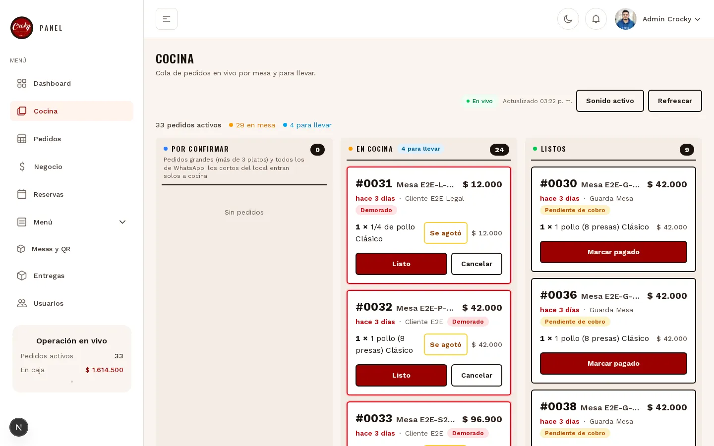
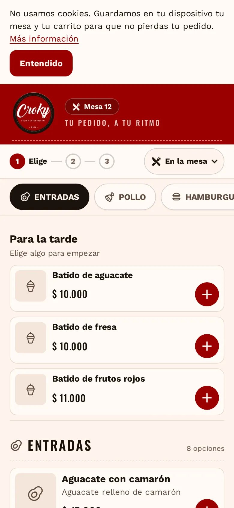
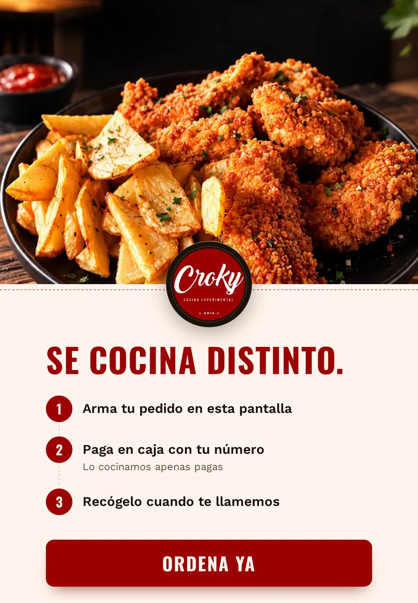
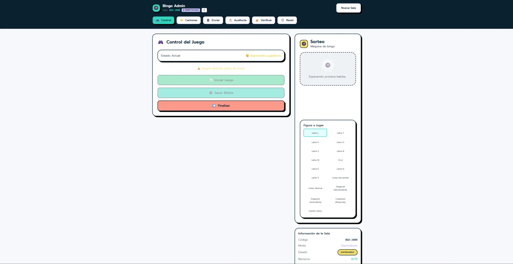
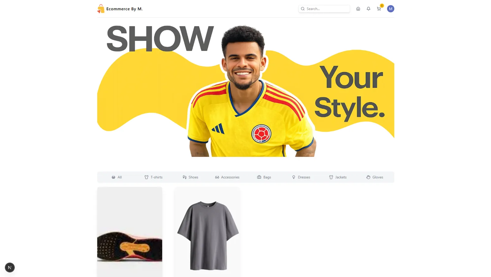
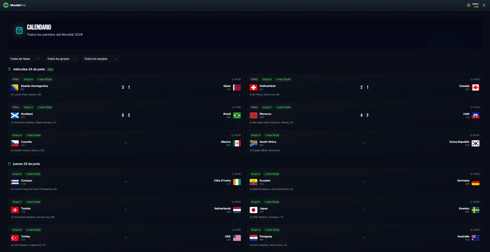
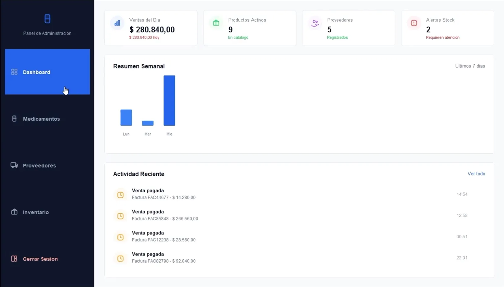

  
  
  
  

## 🎫 Pase de abordar

<picture>
  <source media="(prefers-color-scheme: dark)" srcset="./assets/pass-dark.svg">
  
</picture>

Estudio Ingeniería de Software y hago mis prácticas construyendo un sistema que usa un restaurante real todos los días. Lo que más me interesa es el **backend**: reglas de negocio claras, APIs que no pierden ni duplican datos y pruebas que lo demuestran.

## 🟢 Vuelo principal · MM-01 Crocky

<a href="https://mglabs.live/proyectos/crocky">
  <picture>
    <source media="(prefers-color-scheme: dark)" srcset="./assets/crocky-dark.svg">
    
  </picture>
</a>

Sistema de pedidos para **Croky cocina experimental** (Bogotá). El cliente pide desde el QR de su mesa, el kiosko, WhatsApp o el mostrador, y todo cae en vivo a la misma cocina y caja. El repositorio es privado: el caso completo está en **[mglabs.live/proyectos/crocky](https://mglabs.live/proyectos/crocky)**.

<b>🔍 Ver capturas reales</b>

 

<table>
  <tr>
    <td width="50%"></td>
    <td width="50%"></td>
  </tr>
  <tr>
    <td align="center">PWA de clientes (React 19 + Redux Toolkit)</td>
    <td align="center">Kiosko de caja en iPad</td>
  </tr>
</table>

<b>⚙️ Decisiones técnicas que tomé</b>

 

| Problema | Cómo lo resolví |
| --- | --- |
| Que el dominio no dependa del framework | Arquitectura hexagonal: 15 puertos, el dominio no conoce Express ni Prisma |
| Pedidos duplicados por mala señal | Idempotencia por `requestId` y cola offline en la PWA |
| Sesiones robadas | Refresh tokens opacos (hash SHA-256), de un solo uso y revocación de toda la familia ante reuso |
| Permisos | Roles `OWNER`, `KITCHEN` y `DELIVERY_DRIVER` verificados contra la BD en cada petición |
| Tarifas de domicilio manipulables | Calculadas en el servidor por zonas de distancia (haversine) |
| Cocina sin refrescar | Socket.IO con respaldo por sondeo |
| Confianza para desplegar | 632 casos Vitest + 14 escenarios Playwright E2E en GitHub Actions |
| Operación | Docker Compose, 37 migraciones Prisma, Grafana + Alloy y automatizaciones con n8n |

## 🛫 Otros vuelos

<table>
  <tr>
    <td width="50%" valign="top">
      
      <h3><code>MM-02</code> Bingo Virtual</h3>
      Bingo multijugador en tiempo real para hasta 100 jugadores, con resultados auditables mediante SHA-256 y máquina de balotas en 3D.
        
      
      
      
    </td>
    <td width="50%" valign="top">
      
      <h3><code>MM-03</code> E-commerce</h3>
      Tienda en línea con microservicios independientes (auth, pagos, catálogo, pedidos), JWT y panel administrativo.
        
      
      
      
    </td>
  </tr>
  <tr>
    <td width="50%" valign="top">
      
      <h3><code>MM-04</code> Polla Mundialista</h3>
      Ligas privadas para pronosticar el Mundial, con puntuación automática y tabla de posiciones.
        
      
      
      
    </td>
    <td width="50%" valign="top">
      
      <h3><code>MM-05</code> Farmacia</h3>
      Escritorio para inventario, ventas y reportes, con roles y arquitectura por capas (Singleton + DAO).
        
      
      
      
    </td>
  </tr>
</table>

## 🧰 Stack con evidencia

| Área | Herramientas |
| :---: | :---: |
| **Lenguajes** |  |
| **Backend y datos** |  |
| **Frontend** |  |
| **Calidad y operación** |  |

## 📊 Actividad

<picture>
  <source media="(prefers-color-scheme: dark)" srcset="https://raw.githubusercontent.com/MiguelU-coder/MiguelU-coder/output/snake-dark.svg">
  
</picture>

<b>📜 Certificaciones</b>

 

| Año | Certificación |
| :---: | --- |
| 2026 | Hacking ético y ciberseguridad (Kali Linux) |
| 2025 | Node.js Complete Guide: APIs REST, autenticación, MongoDB, SQL y GraphQL |
| 2025 | Full-Stack Web Development Bootcamp: React, Node.js, PostgreSQL y Git |
| 2025 | Certificación avanzada de JavaScript: ES6+, POO, asincronía y código limpio |

---

### ¿Tienes una vacante o un proyecto?

Este perfil sigue el tablero de salidas de <a href="https://mglabs.live">mi portafolio</a>. Las animaciones son SVG hechos a mano.

